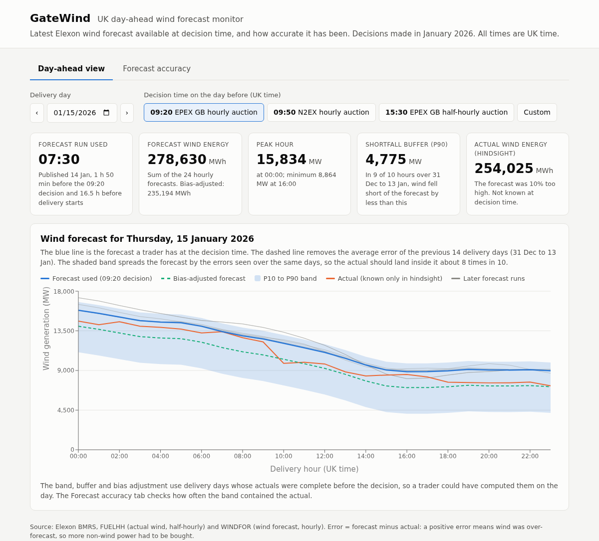
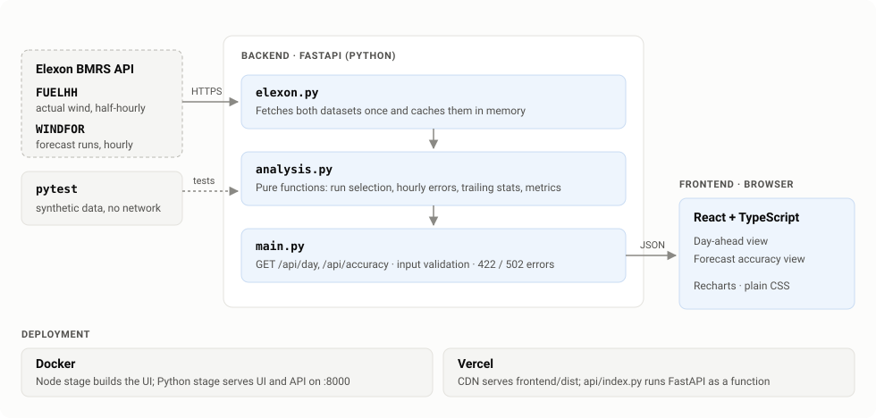

# GateWind: UK Day-Ahead Wind Forecast Monitor

A web app for a UK utility's day-ahead trading desk. Before the day-ahead auction closes, the desk decides how much non-wind power to buy for the next day. The app answers two questions:

1. **What was the latest wind forecast available at decision time?** The app counts forecast runs published before the decision and ignores later ones.
2. **How accurate has that forecast been?** The app measures the forecast's errors over January and adds a bias-adjusted forecast plus an uncertainty band you can size a buffer from.

Scope: decisions made in **January 2026**, which covers delivery days 2 January to 1 February 2026. All data comes from Elexon BMRS: `FUELHH` (actual wind generation, half-hourly) and `WINDFOR` (wind forecast, hourly, 8 runs per day).

**Live app:** https://gatewind.vercel.app



## Key January findings

All figures are for the 09:20 decision (EPEX GB hourly auction) over 744 delivery hours.

| Measure | Raw forecast | Bias-adjusted forecast |
|---|---|---|
| MAE (typical miss) | 2.02 GW (17.9% of mean output) | **1.49 GW (26% lower)** |
| RMSE | 2.50 GW | 1.95 GW |
| Bias (mean forecast minus actual) | **+1.75 GW** | +0.50 GW |
| Actual inside the P10 to P90 band | n/a | 82% of hours (80% expected) |

- **The forecast runs high.** On average it was 1.75 GW above actual wind output, about 15% of the mean. It was too high in 85% of hours, so a desk that buys against the raw forecast ends up short of power in those hours. One plausible cause is curtailment: `FUELHH` reports metered output after constraint actions, and the forecast may not anticipate it.
- **A simple correction works.** The bias-adjusted forecast subtracts the forecast's average error over the previous 14 delivery days. It uses data published before the decision and cuts the typical miss by 26%.
- **Correcting bias beats deciding later.** Moving the decision from 09:20 to the 15:30 half-hourly auction lowers MAE by 8% and leaves the bias at +1.71 GW. Correcting the bias gains more than six extra hours of forecast freshness.
- **The band is calibrated.** The P10 to P90 band contained the actual in 82% of hours, against an expected 80%. Its P90 edge gives a defensible buffer for extra non-wind purchases.
- **The worst hours are overnight.** MAE peaks at about 2.4 GW between 03:00 and 06:00, even though those hours are the closest to the decision.

## Quick start

### Docker (UI and API on one port)

```bash
docker build -t gatewind .
docker run -p 8000:8000 gatewind
# open http://localhost:8000
```

### Local development

```bash
# backend (Python 3.10+)
python -m venv .venv && source .venv/bin/activate
pip install -r backend/requirements-dev.txt
cd backend && uvicorn app.main:app --reload --port 8000

# frontend (Node 20), in a second terminal
cd frontend && npm install && npm run dev   # http://localhost:5173, proxies /api to :8000
```

The first API request downloads about 3.5 MB from Elexon and caches it in memory, so it takes a few seconds. Later requests return at once.

### Tests and lint

```bash
pytest                          # backend unit tests on synthetic data (no network)
ruff check .
cd frontend && npm run build    # type-check and production build
```

GitHub Actions runs all three on every push (`.github/workflows/ci.yml`).

## Using the app

- **Day-ahead view.** Pick a delivery day and a decision time. The chart shows the forecast run the desk would have had, the bias-adjusted forecast, the P10 to P90 band, later runs (grey) and the actual outcome (orange, hindsight only). The KPI tiles show which run the desk used and its age, the day's forecast energy, the peak hour, the P90 shortfall buffer and the actual energy.
- **Forecast accuracy.** This tab gives January error statistics for the chosen decision time: a summary of findings, the raw and bias-adjusted MAE, band coverage, a comparison of the three auction gate times, error by delivery hour and by day, and the error distribution.
- **Decision time.** The presets are the GB auction gate closures. Any other time can be entered with *Custom*.

## API

| Endpoint | Purpose |
|---|---|
| `GET /api/day?date=2026-01-15&decision=09:20` | Run used, KPIs, the trailing-window statistics, and hourly forecast, bias-adjusted forecast, band and actual, plus later runs |
| `GET /api/accuracy?decision=09:20` | MAE, RMSE, bias, quantiles, histogram, by-hour and by-day breakdowns, bias-adjusted metrics with band coverage, and a comparison of the 09:20, 09:50 and 15:30 decision times |
| `GET /api/health` | Liveness check |

`date` must fall between 2026-01-02 and 2026-02-01, and `decision` must be `HH:MM` in UK time. Invalid input returns a 422. If Elexon cannot be reached, the API returns a 502 with a readable message.

## Repository guide

```
api/index.py                 Vercel entry point; exposes the FastAPI app
backend/app/elexon.py        Fetches FUELHH and WINDFOR once and caches them in memory
backend/app/analysis.py      Pure functions: run selection, error pairing, trailing statistics, metrics
backend/app/main.py          FastAPI routes and input validation; serves frontend/dist when present
backend/tests/               pytest tests for the analysis functions (synthetic data, no network)
backend/requirements-dev.txt Test and lint tools (pytest, ruff)
requirements.txt             Runtime dependencies (used by Docker and Vercel)
frontend/src/App.tsx         Layout, tabs and the shared day / decision-time controls
frontend/src/DayView.tsx     Day-ahead view
frontend/src/AccuracyView.tsx  Forecast accuracy view
frontend/src/api.ts          Response types and a small fetch hook
frontend/src/ui.tsx, format.ts, styles.css  Shared components, UK-time formatting, styling
docs/                        Screenshots and the architecture diagram
Dockerfile                   Multi-stage: Node builds the UI, Python slim serves UI and API
vercel.json                  Builds the frontend; Vercel serves api/index.py as the Python function
.github/workflows/ci.yml     ruff, pytest and the frontend build
```

## Design



### System

- **One FastAPI service.** It exposes the JSON API under `/api` and, in Docker, also serves the built React app, so a single container runs everything. On Vercel, the CDN serves the React build as static files and `/api/*` runs as a Python serverless function (`api/index.py`).
- **No database.** The dataset is about 3.5 MB and historical, so the backend fetches it from Elexon on first use and caches it per process (`functools.lru_cache`). It caches per-decision-time results the same way.
- **Pure analysis core.** `analysis.py` does no I/O. Every rule (run selection, the no-look-ahead window, metrics) is a small function with a unit test on hand-built data, so the logic can be checked without the network.
- **Typed frontend.** React with TypeScript and Recharts. `api.ts` types every response. The fetch hook cancels stale requests when inputs change, and the UI shows loading and error states.

### Domain decisions

- **Use the run published at or before the gate.** A trader works from what Elexon has published by the gate. At 09:20 that is the 07:30 run, because the 09:30 run lands 10 minutes late.
- **Join on the hourly `startTime`.** `WINDFOR` is hourly and `FUELHH` is half-hourly. Matching each forecast hour to the half-hour that starts on the hour gives a rule a reviewer can check by hand.
- **No look-ahead.** The bias correction and the band use the 14 delivery days with complete actuals before the decision. That window gave the best-calibrated band (82% coverage against a nominal 80%). The Methodology section compares 7, 14, 21 and 28 days.
- **December warm-up.** Two weeks of December data give 2 January a full window, so every January day follows the same rule. A trader deciding on 1 January already knows December's errors, so this data stays relevant to January decisions.

## Methodology

- **Decision time.** The desk decides on day D-1 at a UK clock time. The presets are:
  - 09:20, the EPEX SPOT GB hourly auction;
  - 09:50, the Nord Pool N2EX hourly auction;
  - 15:30, the EPEX SPOT GB half-hourly auction.

  The app reads times as `Europe/London`, so it handles daylight saving. January is GMT, so UK time equals UTC.
- **Delivery day.** The UK calendar day, 00:00 to 24:00 local time.
- **Forecast run selection.** For delivery day D, the app uses the run with the latest `publishTime` at or before the decision time on D-1, sliced to the hours of D. For a 09:20 decision, the 09:30 run arrives 10 minutes too late, so the trader works from the 07:30 run. A run covers up to 21:00 UTC two days after publication. With a decision before about 02:30, the latest run therefore misses the last hours of the day, and the UI says so.
- **Hourly join.** `WINDFOR` is hourly and `FUELHH` is half-hourly. The app joins forecast and actual on `startTime`, so the actual for hour HH:00 is the FUELHH half-hour starting at HH:00.
- **Error sign.** `error = forecast - actual`. A positive error means the forecast overstated wind, so the desk needed more non-wind power.
- **No look-ahead.** At a decision on D-1, the last delivery day with complete actuals is D-2. The bias adjustment and the band use the errors of the 14 delivery days ending on D-2, all computed with the same decision time. The app also loads two weeks of December data, so 2 January gets a full window.
  - Bias-adjusted forecast = forecast minus the mean error over the window.
  - P10 to P90 band = forecast minus the window's P90 and P10 errors.
  - Shortfall buffer = the window's P90 error.
- **Window length.** The table compares trailing windows for the 09:20 decision:

  | Window | Bias-adjusted MAE | Band coverage |
  |---|---|---|
  | 7 days | 1.61 GW | 71% (too narrow) |
  | 14 days | 1.49 GW | 82% |
  | 21 days | 1.40 GW | 86% |
  | 28 days | 1.41 GW | 86% |

  The 14-day window gives the band closest to its nominal 80% coverage, so the app uses it. Longer windows trim MAE a little more but widen the band past 80%. One month of evaluation data makes this a judgement call; revisit it once a longer history is available.

## Limitations and next steps

- One month of data is a small sample. Validate the window length and the bias estimate on a full year, including summer, when output and curtailment patterns differ.
- The bias correction is a single number per day. It could depend on hour of day or forecast level, given the larger errors overnight.
- `FUELHH` covers transmission-metered wind. Adding solar, embedded generation and demand would give a net-load view.
- Alert the desk when a later run differs from the decision-time run by more than a set threshold (for example 1 GW), to support intraday rebalancing.

## Gate closure references

- EPEX SPOT GB day-ahead auctions (hourly 09:20 and half-hourly 15:30 UK time): https://www.epexspot.com/sites/default/files/2024-07/Trading%20brochure%20July%202024.pdf
- Nord Pool N2EX GB day-ahead auction (09:50 UK time): https://support.nordpoolgroup.com/support/solutions/articles/8000088463-about-the-day-ahead-gb-auction

## Use of AI tools

I used Claude Code as an AI coding assistant while building this project.
